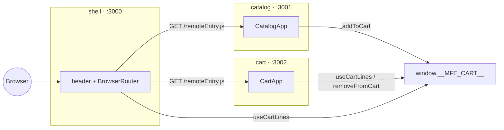
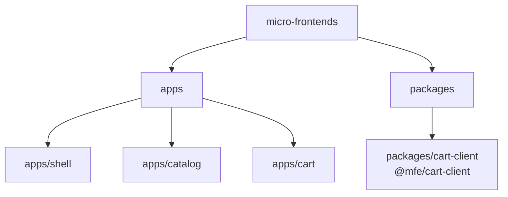
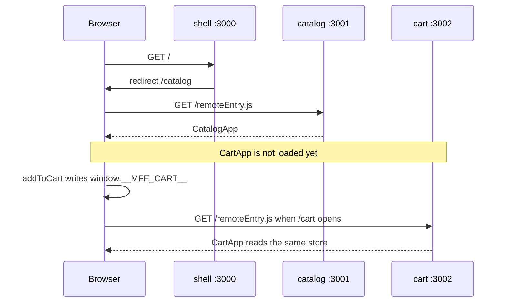
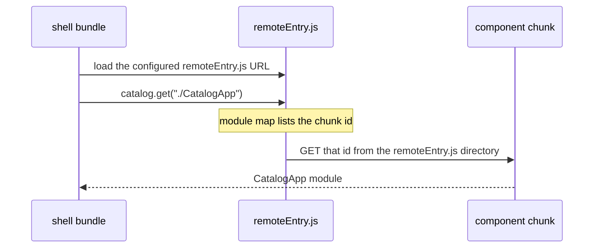
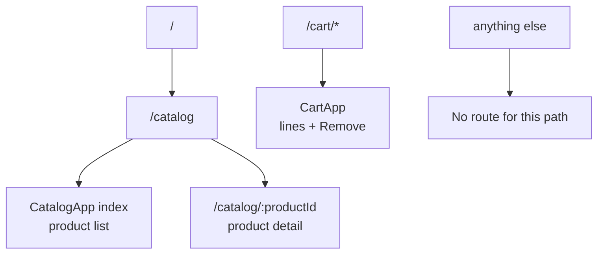
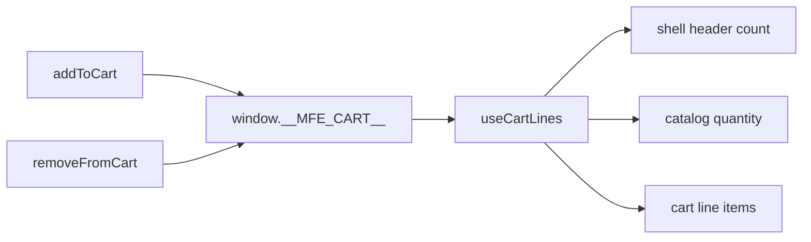

# Storefront micro frontends

Three builds. The shell is the only page the user opens. It downloads each remote at runtime and renders the component that remote exposes. It never compiles catalog or cart source.



## Repo



| Package | Dev server | Public module |
| --- | --- | --- |
| `shell` | http://localhost:3000 | host, no expose |
| `catalog` | http://localhost:3001 | `catalog/CatalogApp` |
| `cart` | http://localhost:3002 | `cart/CartApp` |
| `@mfe/cart-client` | none | bundled into each app |

## Shared dependencies

Do not ship React three times. Hooks and context belong to the React copy that created them. Two copies on one page is an `Invalid hook call`, or a router context the remote cannot see. The shell's `BrowserRouter` is created by the shell's React. Catalog's `<Routes>` must render with that same React.

The decision is the `shared` object in each webpack config. `singleton: true` is set there, not in `package.json`. The same block is in `apps/shell/webpack.config.js`, `apps/catalog/webpack.config.js`, and `apps/cart/webpack.config.js`. The host and the remote both list a library, or the remote will not look for the host's copy.

```js
shared: {
  react: { singleton: true, requiredVersion: "18.3.1" },
  "react-dom": { singleton: true, requiredVersion: "18.3.1" },
  "react-router-dom": { singleton: true, requiredVersion: "6.28.1" },
}
```

`requiredVersion` is the compatibility check. These are exact versions. A remote built with another React does not attach to the host's copy. A range such as `^18.3.1` would allow small patch differences to share. This repo does not do that.

`package.json` still depends on `react`, `react-dom`, and `react-router-dom` in all three apps. `shared` does not remove that. Each app is its own build and must run alone: open http://localhost:3001 and there is no shell, so catalog's webpack must resolve React itself. `npm install` hoists one `react@18.3.1` in this workspace, so disk does not hold three versions.

At runtime inside the shell:

1. The shell puts its React `18.3.1` into the shared scope.
2. Catalog's build still contains a fallback copy from catalog's compile.
3. Catalog asks for `react` as a singleton. That request does not read `node_modules`. The browser has no `node_modules`. It goes to Module Federation's share scope, a registry in the page's memory. The shell already registered its React there, so catalog uses that object and does not run its fallback.

`node_modules` is only used when webpack compiles. Catalog's compile records a fallback copy of React from `node_modules`, plus the runtime request for the singleton. Open http://localhost:3001 alone and the share scope is empty, so catalog runs that fallback. Catalog is the only app on that page, so there is still one React.

Anything not named in `shared` is local to that build. `@mfe/cart-client`, the product list, and the cart UI are local. Each app bundles its own copy. The cart is still one store because the first bundle puts it on `window.__MFE_CART__`, not because Module Federation deduped that package.

Sharing more than the framework means every app upgrades together. Sharing less means three Reacts on one page. This repo shares the framework and the router, and leaves feature code local.

## What loads when



`output.publicPath` is `"auto"`, so catalog's extra chunks stay on port 3001 even though the document is on port 3000. Each app's `src/index.ts` is only `import("./bootstrap")`, so shared React is installed before app code imports it.

## Where `remoteEntry.js` is

It is not a file in the repo. You do not write it. `ModuleFederationPlugin` adds it to the catalog and cart compilations.

| App | Config | Served at |
| --- | --- | --- |
| catalog | `filename: "remoteEntry.js"`, exposes `./CatalogApp` | http://localhost:3001/remoteEntry.js |
| cart | `filename: "remoteEntry.js"`, exposes `./CartApp` | http://localhost:3002/remoteEntry.js |

`npm run dev` runs three compilers. Catalog webpack compiles `apps/catalog`. Cart webpack compiles `apps/cart`. Shell webpack compiles only `apps/shell`. The shell config lists remote URLs. It does not compile catalog or cart source.

Dev has no `dist` folder. Webpack-dev-server keeps each compilation in memory. Stop the servers and `remoteEntry.js` is gone.

`remoteEntry.js` is a manifest, not the whole app. The browser downloads it, reads which chunks `CatalogApp` or `CartApp` need, then downloads those chunks from the same host, for example `http://localhost:3001/src_CatalogApp_tsx.js`. Those chunks are the compiled catalog code. The shell bundle is not rebuilt when catalog changes. Saving a catalog file recompiles catalog in memory, and the next page load fetches the new manifest and chunks.

The shell does not contain `remoteEntry.js`. `apps/shell/webpack.config.js` only lists the two URLs:

```text
catalog@http://localhost:3001/remoteEntry.js
cart@http://localhost:3002/remoteEntry.js
```

## How the shell finds a chunk

Same steps in dev and production. The shell knows the remote URL and the expose name. It does not know chunk filenames. Catalog's compile writes those names into `remoteEntry.js`.

Shell source:

```ts
const CatalogApp = lazy(() => import("catalog/CatalogApp"));
```

Shell webpack rewrites that import into: load the catalog `remoteEntry.js` URL from the shell config, then call `catalog.get("./CatalogApp")`.

| | Dev, this repo | Production, after the remote URL is set |
| --- | --- | --- |
| Shell config | `catalog@http://localhost:3001/remoteEntry.js` | `catalog@https://catalog.example.com/remoteEntry.js` |
| Manifest request | `http://localhost:3001/remoteEntry.js` | `https://catalog.example.com/remoteEntry.js` |
| Where the file lives | webpack-dev-server memory | catalog's deployed output |

The manifest contains a map like this. The chunk id string differs between a dev build and a production build. The shape is the same:

```js
"./CatalogApp": () =>
  Promise.all([
    __webpack_require__.e("src_CatalogApp_tsx"),
    // plus the shared React and CSS chunks
  ]).then(() => __webpack_require__("./src/CatalogApp.tsx"))
```

`__webpack_require__.e` loads a script. The filename function in dev is `chunkId + ".js"`, so `src_CatalogApp_tsx` becomes `src_CatalogApp_tsx.js`. A production build usually hashes that filename. The new hash is inside the new `remoteEntry.js`, which is why the shell does not need the chunk name at compile time.

`publicPath: "auto"` takes the directory of the script that just ran and uses it for every following chunk. Dev and production use that same rule:

| Script that just ran | Chunk request |
| --- | --- |
| `http://localhost:3001/remoteEntry.js` | `http://localhost:3001/src_CatalogApp_tsx.js` |
| `https://catalog.example.com/remoteEntry.js` | `https://catalog.example.com/<hashed-chunk>.js` |

That second file is the compiled component. `get("./CatalogApp")` resolves, and `React.lazy` renders it. Cart works the same way through `cart.get("./CartApp")`.



## Production

This repo has no production script. Every app script is `webpack serve --mode development`.

A production build is `webpack --mode production` once per app. That writes files to disk: `remoteEntry.js` plus hashed chunks. Deploy the three output folders separately. The user still opens only the shell. Catalog and cart are other hosts, for example `https://catalog.example.com/remoteEntry.js`.

The shell remotes in this repo are localhost. A production shell build would keep requesting `localhost:3001` and `localhost:3002` until those URLs are changed to the deployed hosts. After that, a catalog change is: rebuild catalog, upload its output, leave the shell deployed as it is. The next page load fetches the same `remoteEntry.js` URL and gets the new chunks. Rebuild the shell only when a remote URL or the exposed module name changes.

Dev-server CORS headers are not part of the static files. The host that serves catalog and cart must allow the shell origin to load those scripts. The deployed builds must stay on the same React, ReactDOM, and React Router versions, because they are singletons. The cart store is the same in production: `window.__MFE_CART__` for that page load, cleared on a full reload.

## Routes

The shell owns the site URLs. Catalog owns only the remainder under `/catalog`. One `BrowserRouter` in the shell is the history for the whole page. React Router is a shared singleton, so catalog's `<Routes>` and `<Link>` use that same history.

```tsx
<Route path="/" element={<Navigate to="/catalog" replace />} />
<Route path="/catalog/*" element={<CatalogApp />} />
<Route path="/cart/*" element={<CartApp />} />
<Route path="*" element={<p>No route for this path.</p>} />
```

The `/*` keeps the shell route matched when the URL goes deeper, and it leaves the remainder for the remote. Catalog matches that remainder:

```tsx
<Route index element={<ProductList />} />
<Route path=":productId" element={<ProductDetail />} />
```

| URL on the shell | Who matches it | What renders |
| --- | --- | --- |
| `/` | shell | redirect to `/catalog` |
| `/catalog` | shell, then catalog index | product list |
| `/catalog/kb-01` | shell, then catalog `:productId` | that product |
| `/cart` | shell | `CartApp` |
| anything else | shell `*` | "No route for this path." |

Cart has no inner routes. `/cart` and `/cart/anything` both render the same panel.

A product link is `to={product.id}`, relative to the current route. On the shell, `/catalog` plus `kb-01` becomes `/catalog/kb-01`. "Back to catalog" is `to=".."`, which returns to `/catalog`. Header links are absolute: `/catalog` and `/cart`.

### `bootstrap.tsx`

Each app's `src/index.ts` is only `import("./bootstrap")`. That file is the dev-server entry. The shell does not load a remote's `bootstrap.tsx`. It loads the exposed component: `CatalogApp` or `CartApp`.

When you open the shell, the only `BrowserRouter` is in `apps/shell/src/App.tsx`. `apps/shell/src/bootstrap.tsx` mounts that `App`. Catalog and cart render inside it, and their `<Routes>` and `<Link>` use that history because React Router is one shared singleton.

The other `BrowserRouter` is in `apps/catalog/src/bootstrap.tsx`. That file runs only when you open http://localhost:3001 by itself. With no `/catalog` parent, the index route is `/` and the detail route is `/kb-01`. Cart's `bootstrap.tsx` renders `CartApp` with no router, because the cart UI does not read the path.



A refresh of `/catalog/kb-01` still works. The dev server falls back to `index.html`, and `<base href="/">` loads `/main.js` instead of `/catalog/main.js`. The router then reads the real URL. Production uses these same paths on the shell host. The remote hosts serve scripts, not these URLs.

If a remote fails to load, that slot shows "Catalog is unavailable" or "Cart is unavailable". The other route still renders.

## Run one app

One `npm install`, run at the repo root, installs every app. It is not run inside `apps/shell`, `apps/catalog`, or `apps/cart`. The root `package.json` lists `"workspaces": ["apps/*", "packages/*"]`. npm reads each workspace `package.json`, installs the dependencies those files name, and puts the result in the root `node_modules`. That single install covers the shell, catalog, cart, and `@mfe/cart-client`.

There is one `node_modules`, at the repo root. The three apps do not have their own. `node_modules/catalog` points at `apps/catalog`. `node_modules/@mfe/cart-client` points at `packages/cart-client`.

Node resolves a package by walking up parent folders. Catalog imports `react`. There is no `apps/catalog/node_modules/react`, so Node checks `apps/node_modules`, then the root `node_modules/react`. `npm run dev` inside an app finds `webpack` the same way: npm puts the root `node_modules/.bin` on the path.

There is no production build script. Each app's only script is `dev`: `webpack serve --mode development`. That compiles in memory and serves the app. It does not write a `dist` folder.

A package used only by cart is declared only in `apps/cart/package.json`. Leave it out of the shell and catalog `package.json` files, and leave it out of every `shared` block. Then run `npm install` from the repo root. Cart's build bundles it. The shell and catalog do not import it. If no other workspace needs a different version, npm still hoists it to the root `node_modules`. An incompatible second version is placed in `apps/cart/node_modules` instead.

```bash
npm run dev -w catalog
npm run dev -w cart
npm run dev -w shell
```

| Command | What you get |
| --- | --- |
| `npm run dev -w catalog` | http://localhost:3001, its own `BrowserRouter`, list at `/`, detail at `/kb-01` |
| `npm run dev -w cart` | http://localhost:3002, the cart panel only. It has no router |
| `npm run dev -w shell` | http://localhost:3000. Catalog and cart must already be serving, or those slots show unavailable |

`npm run dev` with no workspace flag starts catalog and cart, waits until both `remoteEntry.js` URLs answer, then starts the shell. An app running alone uses its own `bootstrap.tsx`. Inside the shell, only the exposed `CatalogApp` or `CartApp` loads.

## Data sharing

This repo does not use Redux. `@mfe/cart-client` is a plain store: `addToCart`, `removeFromCart`, and `useCartLines`. Each app bundles that package. A module-level variable would be three stores. The first bundle creates the store and hangs it on `window.__MFE_CART__`. The others find that object.

`useCartLines` is `useSyncExternalStore` around that store, so the shell badge, the catalog quantity, and the cart lines re-render from one array. A React context inside `CartApp` cannot do this. Catalog must update the cart while `CartApp` is not mounted.



A full reload clears the cart. The store belongs to that document, so http://localhost:3001 does not share a cart with http://localhost:3000.

Redux would need the same shape: one store object, found by every build. Two ways to get that:

- Hang the Redux store on `window`, the way this cart store is. Each app still bundles the store module. They all read `window` instead of calling `createStore()` again.
- Put that store module in `shared` with `singleton: true`, the way React is shared. Module Federation then runs one copy of the module, and a module-level `createStore()` really is one store.

A provider that lives only inside `CartApp` still fails. It is not mounted on `/catalog`, so catalog cannot dispatch. The provider has to sit in the shell, above both remotes, or the store has to live outside React. This repo uses `window`.
